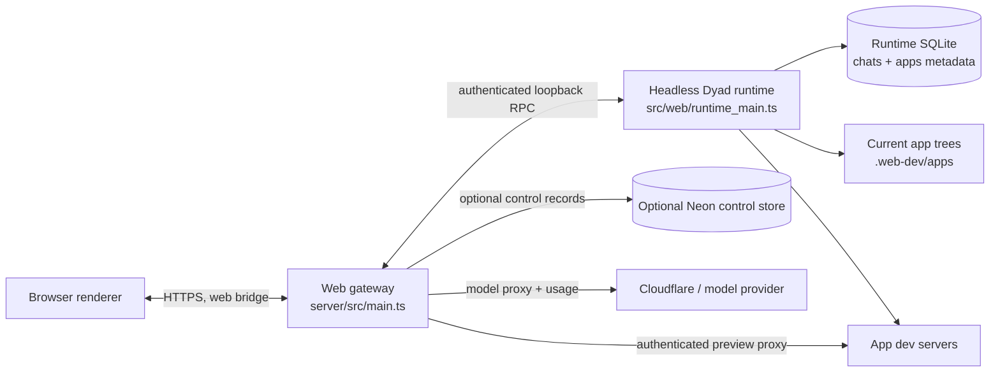
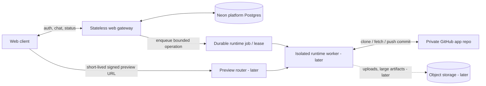

# Seltra web production system design

**Status:** Architecture proposal for review and implementation planning
**Updated:** 2026-10-22
**Audience:** Seltra engineering, Claude, and future contributors

## Goals and decisions

This design reduces Render memory and disk pressure, makes user projects durable across deploys, and gives the team a staged path to a web-only product.

Decisions supplied by the product owner:

- Neon Postgres is available for Seltra's internal platform data.
- Each generated app's canonical source and history will live in a private GitHub repository.
- Object storage is a later phase.
- Isolated runtime workers and a dedicated preview router come after the initial production deployment.
- Resource controls are the immediate workstream.

Keep one important distinction: Seltra's **platform Neon database** is for Seltra users, workspaces, app metadata, jobs, and usage. A generated app's **customer database** (for example its own Neon project) remains a separate integration owned and configured for that generated app. Do not put generated source trees, `node_modules`, build output, browser profiles, model requests, or application database credentials in the platform database.

The immediate plan is not a full Electron deletion. Seltra can ship only its web product while the existing compatibility shim remains. Removing Electron and all native runtime dependencies is a later code migration with its own acceptance gate.

## Current architecture

### Production web process topology

The web launcher currently builds and starts two Node child processes from the same Render service:

1. **Gateway/control plane** — serves the web renderer, authenticates the configured workspace, exposes the model gateway, enforces model-request budgets, and proxies authenticated runtime RPC and previews.
2. **Headless Dyad runtime** — registers the existing Dyad handlers and owns the app database, chat state, file operations, Git operations, package installs, app dev servers, and previews. It is built from `src/web/runtime_main.ts` with `electron` aliased to `src/web/electron-shim/index.ts`.

The browser renderer calls the gateway through the existing web IPC bridge. The gateway calls the runtime over a private loopback RPC endpoint. Generated application dev servers are started by the runtime and exposed through gateway-owned preview URLs.



### Current checkout map

```text
dyad-main/
├─ src/
│  ├─ db/                         # Dyad SQLite schema/database, including app and chat state
│  ├─ ipc/                        # Existing Dyad handlers, services, tools, runtime operations
│  ├─ paths/paths.ts              # App/user-data path resolution; DYAD_APPS_DIR web seam
│  ├─ pro/main/ipc/handlers/local_agent/  # Agent tools, Git, build, test, research, artifacts
│  └─ web/
│     ├─ client/install_bridge.ts # Browser-side window.electron IPC-compatible bridge
│     ├─ electron-shim/           # Web replacements for required Electron APIs
│     ├─ runtime_main.ts          # Headless runtime bootstrap
│     ├─ rpc_server.ts            # Runtime RPC surface
│     ├─ rpc_path_guard.ts        # App-path containment checks
│     └─ preview_urls.ts          # Workspace/app preview host construction
├─ server/
│  ├─ prisma/schema.prisma        # Current Neon/Postgres control-store schema
│  └─ src/
│     ├─ main.ts                  # Web gateway, auth/session, model proxy, budget and preview routing
│     ├─ control_store.ts         # FileControlStore fallback and interface
│     ├─ prisma_control_store.ts  # Current Prisma implementation
│     └─ resilience/              # Circuit breaker
├─ scripts/
│  ├─ build-runtime.mjs           # Builds runtime and aliases Electron to web shim
│  └─ web/dev.mjs                 # Builds and starts runtime + gateway; chooses web state root
├─ runtime/
│  ├─ Dockerfile                  # Runtime image scaffold, not current production isolation
│  ├─ README.md                   # Required future container resource/security policy
│  └─ native/                     # Node-ABI-specific SQLite, PTY, Git and search modules
└─ docs/web-port/                 # Web-port seams, runbook, acceptance, blockers, architecture
```

### Current state and persistence boundaries

- `scripts/web/dev.mjs` defaults `DYAD_WEB_STATE_DIR` to repository-local `.web-dev`. It derives runtime apps, user data, temporary files, logs, and fallback control data beneath that directory (`apps/`, `userData/`, `tmp/`, `logs/`, `control/`). The Render launcher therefore currently keeps generated working trees and much runtime state in one service filesystem tree.
- Without an attached Render persistent disk, filesystem changes are ephemeral across restarts and deploys. A directory named `/var/data` is persistent only if a disk is actually mounted there. See [Render's ephemeral filesystem guidance](https://render.com/docs/deploys#ephemeral-filesystem).
- Runtime app/chat state is still in Dyad's SQLite database under runtime user data. `src/db/schema.ts` stores app identity, local path, GitHub fields, and customer-Neon project/branch fields. The workspace app trees themselves are local directories.
- `DATABASE_URL` currently switches the gateway from `FileControlStore` (`.web-dev/control/control.jsonl`) to `PrismaControlStore`. The current Prisma models are `User`, `Workspace`, `UsageEvent`, `RepairAttempt`, and `Publication`. It does **not** currently contain the platform app catalog, memberships, runtime jobs, or resource leases. Gateway code selects the first workspace for a user; this is a development-shaped tenancy seam, not a finished multi-workspace policy.
- The model gateway persists usage events through the store when configured, but its in-flight counters and run/day budget buckets are process-local maps in `server/src/main.ts`. Those limits reset on restart and are not a cross-instance resource scheduler.
- The app runtime uses `better-sqlite3`, `node-pty`, `dugite`, ripgrep, and other Node-native modules. `runtime/README.md` explicitly leaves container CPU, memory, PID, network, and disk quotas to a future orchestrator. No hard per-app memory/disk quota is currently enforced.
- The `runtime/Dockerfile` is a scaffold and policy sketch. It is not evidence that each app already runs in its own isolated container.

## Target system boundaries



The durable source of truth is the private GitHub repository. Neon is the source of truth for who owns each app, which repository/branch/commit is current, what jobs are running, what resources they may consume, and their observable status. A runtime's local workspace is a disposable checkout/cache. It can be deleted and recreated from GitHub without losing user code.

## What belongs in internal Neon Postgres

### Durable platform records

| Entity | Suggested fields/purpose |
| --- | --- |
| `users` | Seltra identity, login provider subject, email, lifecycle state. Do not duplicate provider secrets. |
| `workspaces` | Owner, name, status, plan/limits, created/deleted timestamps. |
| `workspace_members` | Workspace/user relation, role, invitation and membership state. Add this before promising shared workspaces. |
| `apps` | Workspace, display name, slug, status, GitHub installation/repository ID, canonical repo URL, default branch, last known commit SHA, timestamps, soft-delete state. Avoid a durable local filesystem path as the canonical locator. |
| `app_runs` / `runtime_jobs` | App/workspace, requester, job kind, queued/running/final status, idempotency key, timestamps, bounded result/error class, worker assignment and commit SHA. |
| `resource_leases` | App and workspace lock, resource class/slot, owner worker, heartbeat/expiry, cancellation state. Used to prevent concurrent heavy jobs and conflicting writers across processes. |
| `usage_events` | Existing model role/provider/model, token usage, run ID, success/error class, latency, estimated flag. Batch writes where practical; never store prompts or credentials here. |
| `publications` | Existing deploy/repo/commit/provider identifiers, idempotency, status and URL. Keep provider access tokens out of rows. |
| `repairs` / `artifacts` | Structured metadata and references to evidence. Keep large screenshots/logs out of Postgres; object storage can hold these later. |

### Data that should not be in Neon

- Application source files and `node_modules` trees: private GitHub repos are canonical; local runtime checkouts are disposable.
- Build output, package caches, browser profiles, logs, and temporary test sandboxes: ephemeral worker storage with quotas and cleanup.
- Raw user uploads, generated binary images, large screenshots, and long traces: object storage in a later phase, referenced by scoped object keys.
- GitHub App private keys, OAuth tokens, model keys, database passwords, and app `.env` values: secrets manager or encrypted secret store, never plain app rows, Git remotes, model prompts, or logs.
- Customer app database contents. Internal Neon stores the connection/branch reference only when needed and secrets stay encrypted. The customer database itself is separate.

The current SQLite schema includes product state beyond the app catalog. Before making production deploys disposable, explicitly decide which chats/messages, settings, version metadata, and Experiment 2 artifacts must survive. Migrate durable user-facing state to Postgres or another durable store; do not merely move the app folder and leave the only copy of chat metadata on ephemeral SQLite.

### Neon connection and migration policy

- Use Neon's pooled connection URI for normal service traffic where the current Prisma setup supports it; Neon indicates the pooler by the `-pooler` hostname suffix. Use a separately managed direct connection for schema migrations/administrative work when the Prisma/Neon workflow requires a session connection. Do not put either URI in checked-in files. [Neon pooled URI reference](https://api-docs.neon.tech/reference/getconnectionuri) · [Prisma's Neon guide](https://docs.prisma.io/docs/orm/v6/overview/databases/neon)
- Use `prisma migrate deploy` as an explicit deploy/migration step, not from every app worker startup. Keep migrations serialized and observable.
- Keep internal platform Postgres shared at first; do not create one Neon project per Seltra user/app. Customer-created app databases remain distinct and can use the existing app-level Neon integration.
- Test restart, connection saturation, transaction retry, migration rollback/recovery, and workspace isolation against a non-production Neon branch before switching production reads/writes.

## Resource controls — immediate phase

The screenshot confirms an instance memory limit was exceeded, but does not attribute the peak to a process. The gateway and runtime share one Render service today; generation may also start package installation, app servers, builds, or browser tests. Persistent storage will not by itself reduce RAM. Render's service metrics show memory and disk use and should be reviewed with the service logs around the event time. [Render service metrics](https://render.com/docs/service-metrics#cpu-and-memory-usage)

### First resource-control policy

1. **Instrument before tuning.** Emit structured per-job start/end events with job ID, workspace/app ID, type, queue time, elapsed time, process-tree peak RSS when measurable, disk delta, child process count, cancellation/timeout, and exit class. Never include prompts, environment values, tokens, full user files, or raw secret-bearing command output. Add per-process metrics for gateway, runtime, package manager, preview, build, and browser-test children.
2. **Admission control.** Add a durable job queue and leases. Enforce one active source writer per app. Until measured headroom says otherwise, permit at most one heavy build/install/browser-test job globally on the current single Render runtime; queue additional heavy jobs. Keep chat/model concurrency separate from build/test concurrency.
3. **Bound each job.** Define configured maximum wall time, output/log bytes, child processes, and workspace disk bytes per job class. On cancellation or timeout, terminate the entire child process tree, collect a bounded diagnostic, release the lease, and leave the Git checkout recoverable.
4. **Persist shared budgets.** Move workspace model request/token limits and heavy-job reservations out of gateway-local maps into transactional Postgres counters/leases. A restart or a future second gateway process must not reset usage or allow two workers to acquire the same slot.
5. **Control disk growth.** Clone only the selected app; keep each checkout under an app/job-specific scratch root. Exclude `node_modules`, build output, test results, and caches from GitHub. Add idle cleanup for disposable checkouts and test sandboxes; use a separately bounded dependency cache. Measure retained artifacts and set workspace/app quotas before exposing storage to users.
6. **Hard limits after workers exist.** The current single Render service cannot enforce strong per-app RAM/CPU isolation merely by setting a Node heap limit. Once isolated workers are deployed, enforce cgroup/container memory, CPU, process/PID, ephemeral disk, egress, and time limits. Until then, concurrency/admission controls are mitigation, not a hard memory sandbox.

Render recommends using metrics together with logs for diagnosis. Its persistent disk is tied to one service instance and prevents scaling that service to multiple instances and zero-downtime deploys, so it is not the target shared-workspace architecture. [Render disk limitations](https://render.com/docs/disks#disk-limitations-and-considerations)

## Phase-by-phase implementation plan

This sequencing puts resource controls first, then uses Neon and private GitHub as the durable platform foundation. The first production deployment can still use one web service and ephemeral per-job checkouts. Object storage, isolated workers, and a dedicated preview router are later milestones as requested.

### Phase A — immediate resource controls on current topology

**Scope:** Keep current gateway/runtime deployment, add observability, admission, and cleanup before allowing more generated workloads.

- Measure Render memory/disk/CPU around the 2026-10-21 OOM and reproduce with one controlled build/test at a time. Record whether memory belongs to runtime, pnpm, app dev server, browser, or gateway.
- Add queue/lease records and per-app writer lock to the current Neon-backed store. Start with one heavy job globally on the single runtime until measured peak headroom is known; allow later tuning through config.
- Persist model budget counters/usage atomically; do not treat `MODEL_MAX_CONCURRENT_REQUESTS` as a build process limit.
- Add wall-clock, process-tree cancellation, bounded logs/output, stale-lease recovery, local scratch size checks, and idle cleanup. Establish alerts on Render memory and disk metrics.

**Acceptance:** concurrent heavy jobs queue instead of overlapping; cancellation kills descendants; expired leases are recoverable after restart; limits survive gateway restarts; measured peak usage stays below the service limit in the agreed workload; no source is lost when a job fails.

### Phase B — Neon platform control plane and app/workspace metadata

**Scope:** Promote Neon from optional gateway control storage to required production control storage and add the tenant/app/job model. Keep current runtime/source handling until Phase C is ready.

- Define workspace membership and app ownership explicitly. Add database constraints/indexes for workspace scope and idempotency.
- Add `apps`, `workspace_members`, `runtime_jobs`, and `resource_leases`; reconcile current users/workspaces/usage/repairs/publications. Add canonical GitHub repo fields to `apps`.
- Replace the production `FileControlStore` fallback with a clear fail-fast config rule; retain file store for local tests/development only.
- Decide and migrate the durable subset of the runtime SQLite schema, including chat/message history and artifacts users expect to survive. Do not migrate ephemeral build caches or dependencies.
- Use the Neon pooled runtime connection where compatible, separate the migration path, and test indexes, concurrency/lease transactions, and branch-based migration rollout.

**Acceptance:** one user cannot read/update another workspace's app or run; all durable app rows are workspace-scoped; deploy/restart preserves required chats and app metadata; failed DB admission fails safely; migration is repeatable and has a rollback plan.

### Phase C — private GitHub repositories as canonical app source

**Scope:** Each Seltra app is backed by a private repo; runtime files become disposable clones.

- Create/access private repos using a GitHub App or explicitly authorized GitHub account integration. Persist repository and installation IDs, not long-lived access tokens.
- Add app creation flow: create private repo, initialize/push current scaffold, record default branch and commit SHA in Neon. Add existing-repo import with explicit user authorization.
- Clone/fetch the selected repo into a per-job/per-app scratch directory. Continue using Dyad's existing Git snapshots/tools, but make commit/push success the durability boundary before reporting a completed write run.
- Inject short-lived credentials per Git invocation. Never embed a token in remote URLs or leave it in `.git/config`; preserve the repository's existing Git auth safeguards.
- Make app records resolve to `(workspace_id, app_id, repo_id, branch)` rather than a permanent local `path`. Validate ownership and repository identity on every clone/push.

**Acceptance:** app code and history survive deleting the runtime scratch tree and redeploying; failed push is reported as unsaved/failed rather than completed; cross-workspace repo access is denied; no credentials appear in logs, prompts, remotes, or source.

### Phase D — first production deployment with durable source

**Scope:** Deploy the web experience with Neon + GitHub-backed source on the existing single Render web service before introducing a new worker fleet.

- Configure production `DATABASE_URL`, secrets, health checks, bounded startup, graceful shutdown, and secure GitHub installation credentials. Do not ship `.env.web` or copy local secrets.
- Use ephemeral runtime checkouts and a disposable build/cache directory; do not rely on `.web-dev/apps` for canonical app storage.
- Persist enough control state before an operation begins that a restarted service can reconcile jobs and return each app to a clear state.
- Keep concurrency at the Phase A policy during initial rollout and compare observed memory/disk to the pre-change baseline.
- Do not attach a Render disk as the project source of truth. A temporary disk can be a consciously accepted single-instance bridge, but Render disk limitations must be accepted and documented.

**Acceptance:** deploy/restart does not lose app source, workspace/app metadata, or required chat state; health checks represent true readiness; SIGTERM handles or marks active jobs for retry; one app failure cannot corrupt another app's checkout.

### Phase E — object storage (later)

**Scope:** Move large/binary user data out of Postgres, GitHub where appropriate, and the runtime's disk.

- Choose an S3-compatible object store (for example Cloudflare R2) for original attachments, generated images, large screenshots, logs, and export bundles.
- Store object metadata/ownership/content type/size/hash/retention in Postgres; store bytes under workspace/app-scoped, non-guessable keys. Issue short-lived scoped upload/download URLs after authorization.
- Keep source-code assets required to build/run the generated app in GitHub; keep original inputs and large transient evidence in object storage.
- Enforce per-workspace byte/object quotas, upload size/type checks, lifecycle expiration, and deletion propagation. Do not trust user-provided object keys.

**Acceptance:** web/runtime workers do not need durable local upload storage; authorization prevents cross-workspace access; quota and lifecycle behavior are tested; backups/deletion are observable.

### Phase F — isolated runtime workers (post initial deployment)

**Scope:** Split untrusted/generated app execution and resource-heavy build/test work from the gateway.

- Turn the `runtime/Dockerfile` and `runtime/README.md` scaffold into a worker image only after defining the orchestrator and isolation boundary.
- The gateway submits a typed job to the durable queue; a worker gets a short-lived job identity, clones one repo/commit, executes only the approved Dyad tool/runtime path, then pushes/records a new commit or reports failure.
- Use non-root containers, read-only root, isolated writable scratch, per-job CPU/memory/PID/disk quotas, restricted egress, no Docker socket, no host mounts, and a private authenticated worker RPC. Give each worker only the GitHub and model access needed for its job.
- Worker status/leases live in Neon. Workers must heartbeat, drain on shutdown, support idempotent retry, and release scratch after completion/timeout.
- Do not assign one long-lived mounted filesystem to all app workspaces. Each worker job receives one app's working tree and discards it after durability is established.

**Acceptance:** app A cannot read/write app B's checkout; malicious generated commands cannot reach host metadata/secrets or other workspaces; memory/CPU/PID/disk limits are enforced by the orchestrator; worker crash/cancel/retry preserves the latest pushed commit and truthful run status.

### Phase G — preview routing (post workers)

**Scope:** Route authenticated preview hosts to the worker currently running a specific app revision.

- Worker reports app ID, run ID, private listener/port, commit SHA, and readiness through an authenticated control channel.
- Gateway/router maps an opaque short-lived preview token to the intended workspace/app/run and forwards only to that worker's private endpoint. Do not expose a worker IP/port or accept arbitrary host/path targets.
- Apply origin isolation, CSP/frame rules, WebSocket support, request/body/time limits, TLS, and token expiry. Generated apps are untrusted and must not share cookies/storage with Seltra control UI.
- Stop preview processes after idle TTL, worker replacement, explicit stop, or workspace deletion. Preview stop must not delete the GitHub repo.

**Acceptance:** only authorized workspace members can preview; tokens expire/revoke; preview host cannot reach gateway internals or another app; restart/worker relocation results in a clear unavailable/restarting state rather than stale routing.

## Local development design

- Keep generated project source out of the repository checkout and out of `node_modules`. Set `DYAD_WEB_STATE_DIR` to a user-owned state directory outside the repo for local web development; keep local apps grouped by workspace/app ID.
- For development parity, point the runtime app root at a configurable `DYAD_APPS_DIR` instead of deriving it unconditionally as `<stateDir>/apps`. Keep user data, control state, logs, temp workspaces, and package cache on separately configurable paths so a cleanup does not delete credentials or project source.
- Once private GitHub persistence exists, the local clone is a working copy. A developer may keep it warm locally, but can always remove/reclone it from its private repo. Do not delete user checkouts as part of normal test cleanup.
- Share the Phase A admission/lease policy between local and production behavior, but use platform-specific enforcement: local process-tree/job-object controls and disk checks on Windows; cgroup/container enforcement in deployed workers.

## Web-only product migration

There are two separate goals:

1. **Ship web only:** stop publishing desktop artifacts and make the web deployment the only supported product. This can happen before all Electron-shaped imports are removed, provided the web build has replacements for every API it executes.
2. **Remove Electron from the source/runtime:** replace the current shim and Electron imports with explicit runtime interfaces, remove desktop-only bootstrap/IPC/preload behavior from the web path, and either replace or deliberately retain Node-native runtime modules.

The second goal must audit `src/main.ts`, `src/preload.ts`, all shared `electron` imports, `src/web/electron-shim`, `scripts/build-runtime.mjs`, `scripts/web/native-require-hook.cjs`, `runtime/native`, packaging/Forge scripts, and desktop E2E/build/release workflows. `better-sqlite3`, `node-pty`, `dugite`, and ripgrep are native Node modules even after Electron itself is removed. Do not remove the existing desktop build until web-only acceptance covers chat modes, app file operations, Git, packages, run/build/test, secrets, import, model/voice/media, cancellation, preview isolation, backup/recovery, and deployment/restart durability.

## Open decisions before implementation

1. Is there one workspace per user initially, or must membership/multiple workspaces work in the first schema migration?
2. Does each new app get a private repo in a Seltra-owned GitHub organization or under a user-selected personal/org account? Choose GitHub App authorization accordingly.
3. Which chat history and settings must be durable in v1? Confirm that generated source, chat/messages, app metadata, user settings, Experiment artifacts, and provider links have explicit destinations.
4. What is the initial per-workspace heavy-job concurrency and per-app disk quota? Use memory metrics and a representative generation/build/test workload; do not choose from the 2 GB failure alone.
5. Which Render services will host gateway, Neon, and future worker workloads, and which workloads may access GitHub/model-provider secrets?

## First implementation ticket for Claude

Implement **Phase A only** first. Inspect the current Render OOM logs/metrics and current runtime process tree, then propose a resource budget. Add durable job admission/leases using the existing `ControlStore`/Prisma seams, preserve local development behavior, and add focused tests for concurrency, expiry/restart, cancellation/cleanup, and app writer conflicts. Do not create object storage, runtime workers, preview router, or remove Electron in this phase. Do not claim hard memory isolation until an orchestrator enforces container/cgroup limits.

## External platform references

- [Render ephemeral filesystem and persistence choices](https://render.com/docs/deploys#ephemeral-filesystem)
- [Render persistent disk limitations](https://render.com/docs/disks#disk-limitations-and-considerations)
- [Render service CPU/memory and disk metrics](https://render.com/docs/service-metrics)
- [Neon connection URI and pooler selection](https://api-docs.neon.tech/reference/getconnectionuri)
- [Prisma connection guidance for Neon](https://docs.prisma.io/docs/orm/v6/overview/databases/neon)
